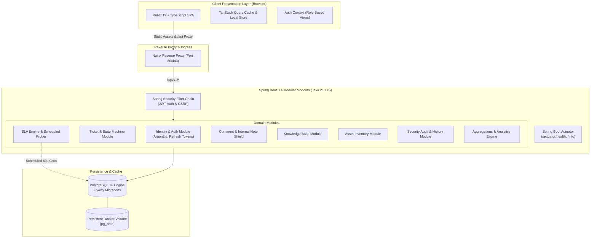

# ResolveIT Helpdesk — System Architecture & Design

## 1. System Overview

ResolveIT is an enterprise-grade IT Helpdesk and Incident Management system designed following the **Modular Monolith** pattern on the backend (Java 21 LTS, Spring Boot 3.4) and a modern single-page application on the frontend (React 19, TypeScript strict mode, Tailwind CSS).

The platform handles the entire incident and service-request lifecycle:
- Ticket creation, triage, assignment, status state machine execution, resolution summaries, and closure.
- Public customer comments versus internal technician notes with strict role-based data shielding.
- Fine-grained Service Level Agreement (SLA) monitoring with dynamic deadline calculation, warning alerts, and automated breach detection.
- RBAC with 4 standard enterprise roles (`ADMIN`, `IT_MANAGER`, `IT_AGENT`, `EMPLOYEE`) plus strict object-level authorization (IDOR protection).
- Security-first authentication: JWT access tokens with rotating refresh tokens, Argon2id/BCrypt password hashing, and audit trails.
- Flyway database migrations with normalized PostgreSQL persistence.

---

## 2. Architecture Diagram



---

## 3. Modular Monolith Package Structure

```
backend/src/main/java/com/resolveit/helpdesk/
├── HelpdeskApplication.java
├── common/
│   ├── exception/          # GlobalExceptionHandler, ProblemDetails, DomainExceptions
│   ├── response/           # PagedResponse, ApiResponse, ErrorResponse
│   ├── validation/         # Custom bean validation annotations & validators
│   └── util/               # DateTimeUtils, SecurityUtils
├── config/                 # SecurityConfig, OpenApiConfig, JpaAuditingConfig
├── security/
│   ├── jwt/                # JwtTokenProvider, JwtProperties, TokenBlacklist
│   └── filter/             # JwtAuthenticationFilter, RateLimitingFilter
├── identity/               # User, Role, RefreshToken, UserRepository, AuthService
├── category/               # Category, CategoryRepository, CategoryService
├── team/                   # Team, TeamMembership, TeamService
├── ticket/                 # Ticket, TicketStatus, TicketStateMachine, TicketService
├── comment/                # Comment, CommentType, CommentService
├── history/                # TicketHistory, TicketHistoryService
├── sla/                    # SlaPolicy, TicketSla, SlaCalculationService, SlaScheduler
├── knowledgebase/          # KnowledgeArticle, KnowledgeArticleService
├── asset/                  # Asset, AssetRepository, AssetService
├── notification/           # Notification, NotificationService
├── audit/                  # SecurityAuditEvent, AuditService
└── dashboard/              # DashboardService, DashboardController
```

---

## 4. Key Architectural Decisions

1. **Modular Monolith over Microservices**: Reduces network serialization latency, avoids distributed transaction complexity (Saga / 2PC), simplifies continuous integration, and provides atomic transactions for ticket transitions and SLA recording.
2. **PostgreSQL & Explicit Flyway Migrations**: Avoids runtime schema mutability. All schema migrations are strictly versioned (`V1__...`, `V2__...`).
3. **Optimistic Locking**: Tickets and SLAs use `@Version` to prevent lost updates when multiple agents open the same incident ticket.
4. **State Machine Enforcement**: State transitions cannot be set arbitrarily; valid transitions are validated via `TicketStateMachine` enforcing required attributes (e.g. resolution summary on `RESOLVED`).
