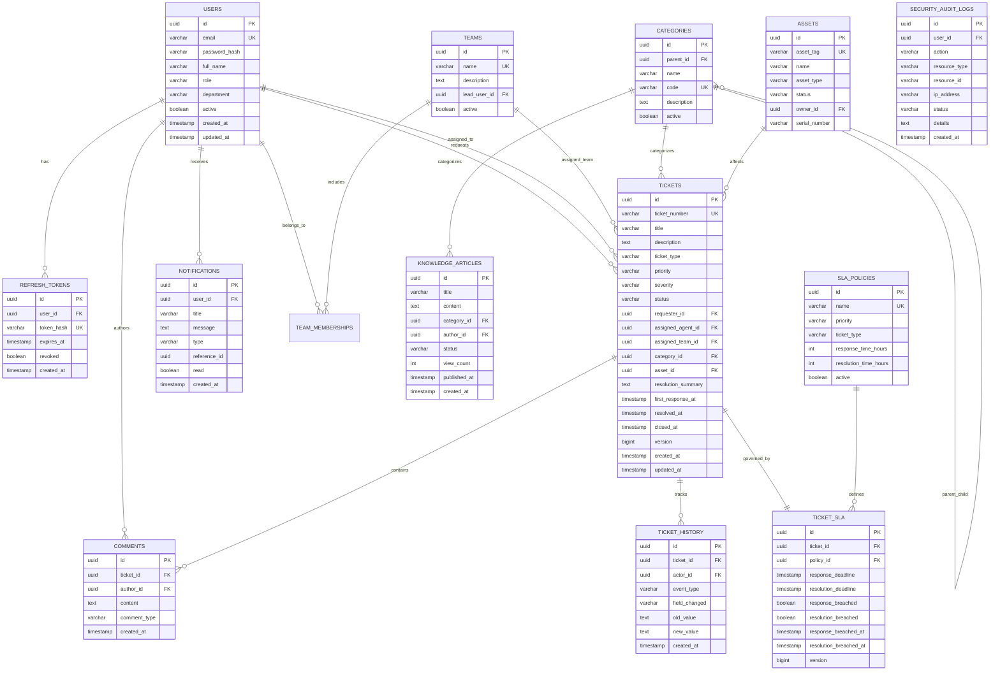

# Database Design & Schema Specification

## 1. Schema Overview

The ResolveIT database is hosted on PostgreSQL 16. Primary keys use UUIDs for non-sequential, tamper-resistant identifiers, while tickets also maintain a human-readable unique sequential reference (e.g., `INC-2026-00142`).

All timestamps are stored in UTC using `TIMESTAMP WITH TIME ZONE`.

---

## 2. Entity-Relationship Diagram (Mermaid)

---

## 3. Indexing & Performance Strategy

1. **Ticket Filtering Indexes**:
   - `CREATE INDEX idx_tickets_status ON tickets(status);`
   - `CREATE INDEX idx_tickets_priority ON tickets(priority);`
   - `CREATE INDEX idx_tickets_requester ON tickets(requester_id);`
   - `CREATE INDEX idx_tickets_assigned ON tickets(assigned_agent_id);`
   - `CREATE INDEX idx_tickets_created_at ON tickets(created_at DESC);`
   - `CREATE UNIQUE INDEX idx_tickets_number ON tickets(ticket_number);`
2. **SLA Breach Prober Optimization**:
   - `CREATE INDEX idx_sla_unresolved ON ticket_sla(resolution_deadline) WHERE resolution_breached = FALSE;`
   - `CREATE INDEX idx_sla_unresponded ON ticket_sla(response_deadline) WHERE response_breached = FALSE;`
3. **Comments & History**:
   - `CREATE INDEX idx_comments_ticket ON comments(ticket_id, created_at ASC);`
   - `CREATE INDEX idx_history_ticket ON ticket_history(ticket_id, created_at ASC);`
4. **Audit & Notifications**:
   - `CREATE INDEX idx_notifications_user_unread ON notifications(user_id, read) WHERE read = FALSE;`
   - `CREATE INDEX idx_audit_created ON security_audit_logs(created_at DESC);`
