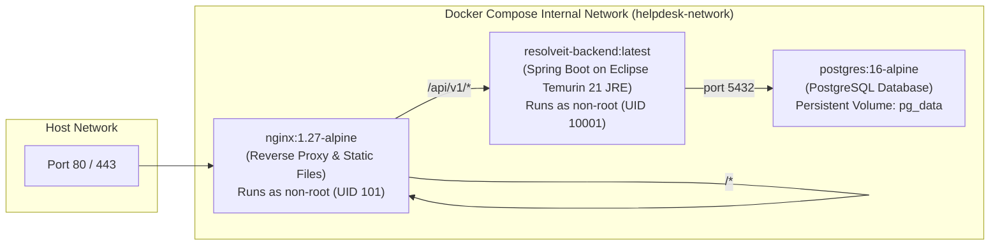

# Deployment & Infrastructure Guide

## 1. Docker Topology & Service Overview

ResolveIT is deployed using Docker Compose with separate topologies for **development** (`compose.yaml`) and **production** (`compose.prod.yaml`).



---

## 2. Environment Variables & Configuration

Copy `.env.example` to `.env`:
```bash
cp .env.example .env
```

Key environment properties:
- `POSTGRES_DB`: Name of the database (`resolveit_db`).
- `POSTGRES_USER`: Database application user (`resolveit_app`).
- `POSTGRES_PASSWORD`: Strong password (generate with `openssl rand -hex 24`).
- `JWT_SECRET`: Base64-encoded 256-bit secret for signing HMAC-SHA256 tokens (min 32 characters).
- `JWT_ACCESS_EXPIRATION_MS`: Access token lifetime in milliseconds (e.g., `900000` = 15m).
- `JWT_REFRESH_EXPIRATION_MS`: Refresh token lifetime in milliseconds (e.g., `604800000` = 7d).
- `SPRING_PROFILES_ACTIVE`: `prod` or `dev`.
- `CORS_ALLOWED_ORIGINS`: Permitted frontend origins (e.g. `https://helpdesk.company.com`).

---

## 3. Quick Start Commands

```bash
# Start full development stack with hot reloading
make up

# Rebuild images from scratch
make build

# View logs from all services
make logs

# View backend health status
make health

# Execute all test suites
make test

# Graceful shutdown
make down
```

---

## 4. Multi-Stage Dockerfile Strategy

### Backend Dockerfile (`backend/Dockerfile`)
1. **Stage 1 (Builder)**: `maven:3.9.9-eclipse-temurin-21-alpine`
   - Pre-downloads dependencies using `mvn dependency:go-offline`.
   - Compiles and packages application using `mvn clean package -DskipTests`.
2. **Stage 2 (Runtime)**: `eclipse-temurin:21-jre-alpine`
   - Creates unprivileged user and group: `addgroup -S spring && adduser -S spring -G spring`.
   - Copies compiled JAR from builder.
   - Configures JVM memory ergonomics: `-XX:+UseContainerSupport -XX:MaxRAMPercentage=75.0`.
   - Exposes port 8080.
   - Healthcheck: `wget --no-verbose --tries=1 --spider http://localhost:8080/actuator/health || exit 1`.

### Frontend Dockerfile (`frontend/Dockerfile`)
1. **Stage 1 (Builder)**: `node:22-alpine`
   - Installs dependencies with `npm ci`.
   - Runs `npm run build` to output production static assets in `dist/`.
2. **Stage 2 (Runtime)**: `nginxinc/nginx-unprivileged:1.27-alpine`
   - Copies static assets into `/usr/share/nginx/html`.
   - Sets custom `nginx.conf` for reverse proxying `/api/v1/` to the backend service.
   - Runs non-root on port 8080 (mapped to 80/443 on host).
