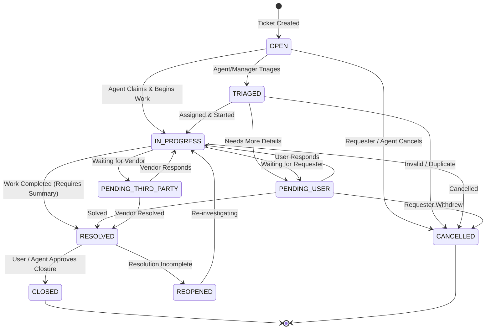

# Ticket Lifecycle & State Machine Specification

## 1. Ticket States

| Status | Code | Description | Next Permitted States |
|---|---|---|---|
| **Open** | `OPEN` | Newly logged ticket awaiting triage. | `TRIAGED`, `IN_PROGRESS`, `CANCELLED` |
| **Triaged** | `TRIAGED` | Category, priority, and initial team verified. | `IN_PROGRESS`, `PENDING_USER`, `CANCELLED` |
| **In Progress** | `IN_PROGRESS` | Agent is actively investigating or working. | `PENDING_USER`, `PENDING_THIRD_PARTY`, `RESOLVED`, `CANCELLED` |
| **Pending User** | `PENDING_USER` | Awaiting information, reproduction, or verification from requester. | `IN_PROGRESS`, `RESOLVED`, `CANCELLED` |
| **Pending Third Party** | `PENDING_THIRD_PARTY` | Awaiting hardware vendor, cloud provider, or external supplier. | `IN_PROGRESS`, `RESOLVED`, `CANCELLED` |
| **Resolved** | `RESOLVED` | Fix or service completed. Requires `resolutionSummary`. | `CLOSED`, `REOPENED` |
| **Closed** | `CLOSED` | Formally closed after requester confirmation or timeout. Terminal. | None (or `REOPENED` if within grace period) |
| **Reopened** | `REOPENED` | Issue recurred or resolution was unsatisfactory. | `IN_PROGRESS`, `TRIAGED` |
| **Cancelled** | `CANCELLED` | Duplicate, withdrawn, or invalid request. Terminal. | None |

---

## 2. State Transition Diagram (Mermaid)

---

## 3. Transition Preconditions & Business Rules

1. **Resolution Enforcement**:
   - Transitioning to `RESOLVED` MUST include a non-empty `resolutionSummary` (min 10 characters).
   - The ticket must have an assigned agent.
   - Sets `resolvedAt` timestamp and stops the SLA resolution timer.
2. **First Response Timestamp**:
   - The first transition out of `OPEN` or the first public agent comment records `firstResponseAt` and completes the SLA response metric.
3. **Closing Rules**:
   - Tickets can only transition to `CLOSED` from `RESOLVED`.
   - Closed tickets freeze modifications (no comments, no reassignment).
4. **Reopening Rules**:
   - Only `RESOLVED` or recently `CLOSED` tickets can be reopened.
   - Reopening resets resolution state and records an escalation audit entry.
5. **Optimistic Locking**:
   - All state transition requests MUST provide the entity `version`. If another agent has updated the ticket concurrently, a `409 Conflict` (OptimisticLockException) is returned.
